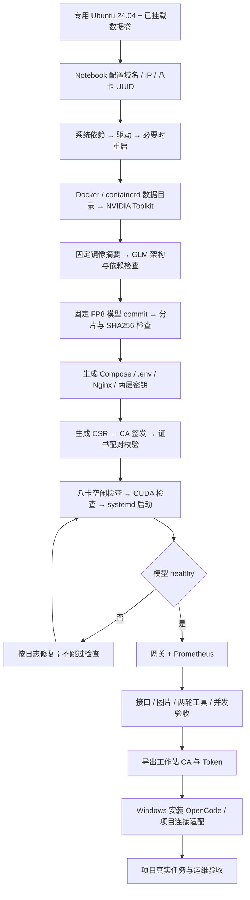
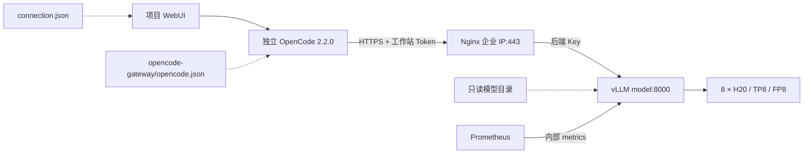

# 部署与请求流程





服务器目录（默认根目录；首次可在 Notebook 中设置 `data_root`）：

```text
/srv/phyxi/
├── docker/、containerd/        独立于系统盘的容器数据
├── models/glm53-flash/commit/  固定模型权重
├── cache/                     编译缓存
├── prometheus/                监控数据
├── secrets/                   API Key、工作站 Token、TLS 文件
├── artifacts/                 版本、镜像/模型清单、CSR
├── evidence/                  接口与负载验收结果
├── client-export/             仅管理员可读的工作站分发材料
├── releases/发布编号/          Compose、启动脚本、网关配置、.env
└── current -> releases/发布编号/
```
