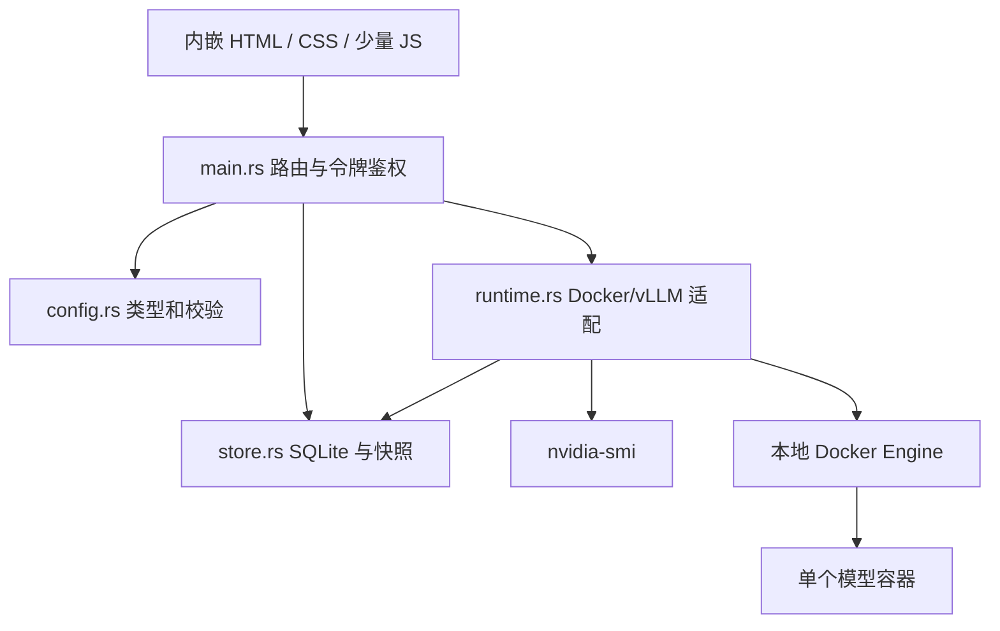

# 轻量架构与模块分工

## 当前范围

一个服务进程、一份 SQLite、一套静态页面、一个受控模型容器。Rust 负责所有配置校验、状态管理和进程调用；浏览器仅负责表单与展示，每 2 秒增量获取任务事件。首版轮询足够，不增加 WebSocket/SSE 基础设施。

## 所有权和职责

| 模块 | 负责 | 不负责 |
|---|---|---|
| `main.rs` | HTTP、启动配置、单写入者锁、任务互斥、提交和取消、令牌鉴权 | 拼接模型参数、安装依赖 |
| `config.rs` | 严格配置结构、字段约束、GPU/TP 一致性 | 自动推断硬件容量、宣称模型兼容 |
| `store.rs` | 草稿、不可变任务配置快照、事件、任务状态、重启标记 | 根据数据库猜测实际容器健康 |
| `runtime.rs` | GPU 读取和空闲检查、命令参数向量、容器归属、镜像准备、启动/停止/健康 | 调用 shell、操作外部任务、自动分配共享 GPU |
| `web/` | 参数表单、GPU 勾选、任务和日志展示 | 保存权威状态、执行业务命令 |

所有变更操作串行，一个 semaphore 保护一个模型生命周期；文件锁防止两个进程使用同一数据库。每个状态目录有持久化 owner UUID，所有容器操作必须校验 label。不同状态目录仍使用同一容器名，冲突时拒绝操作，首版明确不支持同一 Engine 多实例。

配置草稿修改不改变已运行任务的快照。模型真实状态来自 Docker。`succeeded` 表示该任务曾完成，并不表示模型现在仍健康；当前运行状态另行查询，页面明确显示“容器运行中”。

## 任务状态

`running → succeeded | failed | cancelled`；服务重启把遗留 `running` 改为 `interrupted`。不自动重放，不在失败后自动清理证据。任务步骤和实际命令输出写入 SQLite；浏览器按事件序号读取，每次最多 200 个事件。

取消是合作式的：镜像准备结束、模型健康等待循环检查取消标志。模型可能已创建，必须明确停止清理。Docker 命令有超时；超时表示结果可能不确定，后续操作先检查真实容器。

## 从三个平台吸收的内容

- GPUStack：显式 GPU 资源分配、模型实例的唯一管理者、运行状态查询。
- Xinference：模型参数表单、可复用配置、引擎相关参数的独立边界。
- Semaphore：任务提交、不可变配置快照、实时日志、运行记录。

早期不同时部署三套服务。后续只有出现具体需求时才加入平台适配；接口围绕 `inspect / start / stop / logs / inventory` 演进，平台适配器只实现其真实能力。接入后同一实例不能同时归 direct Docker 与平台管理，GPU 池必须隔离。不提前创建空插件系统或未实现的 UI 入口。

## 后续触发条件

1. 目标模型实测需要 → 增加对应模板/参数与兼容性验证。
2. 需要企业客户端正式使用 → 迁移 TLS 网关、鉴权、业务验收；通过后再开放企业入口。
3. 多模型资源调度需求成立 → 评估 GPUStack 适配。
4. 不同模型类型确有需要 → 评估 Xinference 独立 GPU 池。
5. 主机初始化工作变多 → 评估 Semaphore 运维适配。

不在首版实现模型市场、租户计费、Kubernetes、分布式队列、多节点调度与自动扩缩容。
