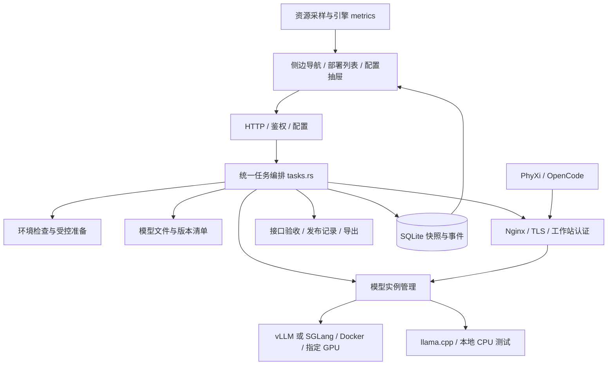

# 融合架构与职责

当前企业容器分层、安全及实施状态以 [企业完整方案](enterprise-plan.md) 为准。下文同时说明原生兼容测试路径。

## 目标

面向“Ubuntu + 已有驱动”的单服务器交付，覆盖环境到业务入口的完整最小闭环。借鉴三个项目的功能划分，实现在同一个产品内；不是安装三个平台，也不是让用户同时管理三套状态。

当前保留已实现且经过测量的 Rust/Axum API。分层与 FastAPI 等 Web 后端相同：HTTP DTO/鉴权 → 应用任务 → 领域配置与状态 → 运行时/系统适配。轻量由进程数、数据结构、采样频率和实际 RSS 保证，语言可按后续需求调整。

## 功能来源与落地模块

| 借鉴职责 | 当前融合实现 | 边界 |
|---|---|---|
| GPUStack 的资源/实例管理 | `runtime.rs`：GPU发现、占用复核、单实例归属、镜像和启动参数、日志 | 只管理所属实例，不安装系统环境 |
| Xinference 的模型/引擎配置 | `catalog.rs` + `config.rs` + `process.rs`：typed配置、vLLM/SGLang/CPU后端选择、模型能力验收选项 | 三个后端互斥；CPU仅供轻量本地验证，不假称完整 Xinference 功能 |
| Semaphore 的运维执行 | `tasks.rs` + `environment.rs`：环境检查、固定安装计划、任务日志、失败状态 | 系统任务不另外启动模型；没有任意 shell 输入 |
| PhyXi 统一控制 | `main.rs` + `store.rs`：鉴权、快照、串行变更、状态和结果 | 不复制三个平台的全部 API/UI；不依赖它们的服务 |
| Prometheus/Grafana 的观察职责 | `telemetry.rs`：有界近期采样、文本 metrics；引擎指标按需读取 | 不把步骤进度当运行指标；外部监控可选 |
| 企业网关与客户端 | `gateway.rs` + `verification.rs`：TLS、网段、认证、SSE、验收和导出 | 不负责模型加载/资源分配；私钥不离开服务器 |

`artifacts.rs` 单独处理固定 revision 的公开模型文件，不在 API/页面中下载权重，不执行远程仓库代码。

## 配置、运行与发布

独立的模型、镜像、运行参数、部署、网关和工作区记录由 `catalog.rs` 验证，`catalog_api.rs` 负责 CRUD、引用解析与实例归属检查；`config.rs` 是组合后传给运行时的强类型配置，不再是前端唯一草稿。配置库存于 SQLite 的 `catalog-v1`，每类最多 100 条，修订号用于检测陈旧写入；外键引用由应用层在串行写入锁内验证。

配置草稿通过强类型 DTO 保存。开始任务时固定模型和网关配置；模型快照在 jobs 表，网关快照在 `task-context:<id>`。完整依赖树和各记录修订号保存在 `composition:<id>`，发布记录也保存该快照。任务互斥避免并发修改实例；执行期间拒绝配置写入，任务结束后可编辑共享配置，而运行实例继续使用启动快照。数据库持久化快照与事件，不承担“容器一定活着”的推断。

模型真实状态通过 Docker inspect 或受控 child handle 获取。网关只使用正在运行的模型配置。验收拒绝草稿和实际实例不一致；发布强制经当前匹配的 TLS 网关重新检查，失败不写入新发布记录。发布成功导出最少工作站材料，不导出 server.key。

首版“发布”是完成验收并记录当前服务版本，不提供蓝绿切流。单份 GPU 资源上切换模型需要停机窗口。旧发布快照可以人工恢复参数，但不宣称自动回滚已实现。

## 主机权限

控制台运行于普通账号，只有安装到固定 root 所有路径的二进制可以通过 sudo 执行 `--prepare-host`。没有用户可拼接的 root 命令、包名或系统路径。安装限定 Ubuntu 22.04/24.04，必须已有可用 NVIDIA 驱动；GPU存在计算进程或 Docker存在容器时拒绝环境变更。

安装使用官方签名 APT 源，固定 Toolkit 版本；Docker初次安装采用源中可用版本，并输出实际包版本。已有不同管理源配置不覆盖。包安装期间临时禁止自动启动服务，已有 policy-rc.d 保留；只在无容器前提下配置/重启 Docker。Nginx 默认系统服务不会由控制台启动；企业模式为 Compose 管理的独立容器，原生测试为受控子进程。

## 执行与观察

任务状态 `running → succeeded / failed / cancelled`；重启遗留状态转 interrupted。浏览器每 3 秒读取任务及最近 200 条事件（API 仍支持游标增量），隐藏标签页暂停轮询；每 10 秒采集控制台RSS/CPU和GPU，最多120项。

下载使用实际命令进度和文件序号；模型加载显示阶段/日志；不展示虚假的时间百分比。取消在边界检查，包管理器/当前文件下载不被强制打断。验收报告保存实际模型响应与测试结果，失败覆盖旧的成功报告。

CPU引擎与Nginx使用 kill-on-drop 子进程句柄，进程重启后不按旧PID发信号。Docker有独立 owner label 和重启策略，控制台退出不自动停止其模型容器。

## 后续范围

优先目标服务器验证：系统安装、Docker GPU可用性、小模型vLLM、实际目标模型参数、真实企业CA及OpenCode接入。按实测补充参数模板。多节点、租户、Kubernetes、计费、自动扩缩容、平台级GPU调度都不在当前范围内。

## 下载并发与中断

`job_control.rs` 管理每个任务的资源占用与独立取消标记。模型权重、推理镜像及网关准备最多 3 项并行；相同下载来源、同一权重仓库版本目录和同一网关组件不可重复执行。草稿保存使用独立配置互斥锁，允许在任务执行时新增或修改；每次任务在提交时保存配置与依赖快照，草稿变化不改写任务。下载来源设置、配置删除与证书应用等共享资源操作仍受执行锁保护。

模型启停、重新部署、网关变更及宿主机安装/修复保留独占控制锁；第一版不让这些操作与下载交叉修改运行环境。超过并发上限返回 409，不隐式排队。

前端中断调用 `POST /api/actions/cancel?job_id=<任务ID>`，只设置指定任务的取消标记。无 ID 的旧接口仅在恰有一个活动任务时兼容；多个任务时拒绝，避免误取消。宿主机安装/修复仍不可强制中断。任务退出自动释放资源；执行器重启按原有机制将遗留任务标为 interrupted。
