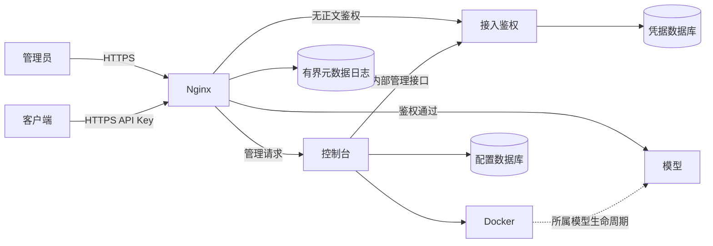

# PhyXi 企业部署架构与分阶段开发方案

状态：P0–P4 已完成本地实现与验证，GPU 推理和真实企业证书/客户端仍需目标服务器验收。各阶段证据见开发纪要。

## 需求基线

单服务器、一套控制台、一个运行模型；允许多个部署草稿。少数运维共享管理员账号，企业内网通过 HTTPS 和密码登录。业务客户端来自内网或 VPN，每个工作区一个有效 API Key，可独立撤销；撤销成功后的新鉴权拒绝，已经通过鉴权的请求允许完成。正式证书上传，自签仅供回环测试。记录管理操作和工作区请求时间、状态、耗时，不记录正文、密钥、Cookie 或带敏感查询参数的完整 URL。允许短暂停机；联网安装；手动加密备份恢复。共享账号不能追溯具体个人。

## 分层与容器

| 层 | 组件 | 职责与权限 |
|---|---|---|
| 管理 | console（Rust＋静态前端） | 密码会话、配置、任务、审计查询、备份；唯一持有 Docker socket 的服务 |
| 接入 | gateway（Nginx） | HTTPS、管理/业务入口、受控路由、流式转发、请求元数据日志；不持有 Docker socket |
| 接入 | access（轻量 Rust） | 工作区、密钥摘要、实时鉴权与撤销；不接收推理正文，不管理容器 |
| 执行 | model（vLLM 或 SGLang） | 单模型推理、指定 GPU UUID、只读权重；无对外发布端口 |
| 主机 | Docker、驱动、Toolkit、文件系统 | 运维安装脚本准备；禁止在控制台容器内假装安装宿主机依赖 |

console/access 共用 Rust 工程及必要基础库，分别运行；不使用 Redis、消息队列、外部数据库、独立前端服务、SSO、Kubernetes。Compose 管理固定基础服务，console 管理动态模型；不让两者争夺同一模型容器。CPU 后端只用于受控本地验证。

控制台重启不影响已有模型、网关、鉴权；鉴权故障拒绝新请求，不降级放行。Docker 重启策略只代表进程恢复，模型还须健康与最小推理检查。独立 Docker 网络隔离入口、管理和推理访问；模型不得访问凭据管理接口。生产不用 host 网络。管理入口、业务入口逻辑分开，只有网关发布端口。

## 配置管理契约

| 页面/对象 | 保存内容 | 引用与操作 |
|---|---|---|
| 模型权重 | 来源、固定版本、站点、本地路径 | 新建、下载、检查；来源不是 Docker 镜像 |
| 运行环境 | 引擎、镜像地址、本地准备状态 | 预设 vLLM/SGLang 或自定义；按钮统一为“下载推理引擎镜像” |
| 推理参数 | 引擎、上下文、并发、显存比例、解析器 | 独立编辑、复制、校验；不含模型路径或证书 |
| 部署实例 | 服务模型名、权重/环境/参数引用、GPU UUID | 草稿、组合检查、部署、停止、重新部署、验收；TP 由 GPU 数量推导 |
| 企业网关 | 域名、证书、规则、目标部署 | 草稿、证书检查、应用配置；首期一个活动网关 |
| 工作区 | 名称、网关、状态、一个有效密钥 | 启停、生成/重置/撤销、导出；不创建模型或容器 |
| 服务器环境 | 资源、版本和依赖状态 | 观察；安装是独立宿主机运维动作 |
| 操作记录 | 对象、动作、结果、任务、快照 | 有界查询；不保存敏感输入 |

独立资源不反向绑定部署，可被多个草稿复用。配置有 revision，拒绝陈旧覆盖。保存不启动、不下载、不改变运行实例。镜像地址供填写，本地镜像 ID 由 Docker 读取，仅在折叠详情与执行记录展示。执行时固定镜像 ID 和完整依赖快照。模型资源状态为未准备/下载中/已准备/失败/缺失，镜像对应拉取状态；启动时再次检查。

部署页分为组合、GPU、实际运行、企业接入卡片。显示当前草稿与运行快照的差异，并明确“未应用”。预览组合 → 展示变更及停机提示 → 执行 → 验收。模型文件/引擎/GPU/参数变化需重建模型；证书和网关规则校验后应用；工作区撤销是即时安全操作，不等待模型部署。服务模型名最终迁至部署，迁移保持旧行为。

删除配置和清理资源是不同动作。被引用或活动的记录禁止删除；外部文件不自动删除；共享/活动资源禁止清理。首期允许先仅提供配置删除，不实现自动磁盘清理。工作区停用撤销后归档，审计保留。首期不做配置分支或复杂审批。

## 安全与数据归属

- console 使用 Argon2id 密码哈希、服务端会话、Secure/HttpOnly/SameSite Cookie、CSRF 校验、失败限速、过期和退出；改密码撤销会话。首次初始化通过本机/SSH，不提供默认密码。
- access 独占凭据数据库；console 经带独立服务凭据的内部管理接口访问。不共写数据库。工作区密钥高熵、仅展示一次，存储摘要；撤销落盘并更新校验状态后才返回成功。网关不缓存鉴权成功。已有流不重新校验。
- Nginx auth_request 不传正文；可信工作区 ID 由鉴权返回，不信任客户端伪造头。只允许声明的推理路由；不把客户端 API Key 传给模型。
- 证书验证链、域名、有效期、公私钥匹配；先验证后替换。私钥限制权限，不写日志或配置列表。没有企业 CA 签发功能。
- 仅 console 持 Docker socket；这相当于高权限宿主机管理能力，非 root 用户不能消除此权限。固定 argv、所属标签、挂载路径约束；不开放任意 Docker 命令或 shell。
- 请求日志仅 workspace_id、request_id、时间、路由类别、状态、耗时；不记录正文/Authorization/Cookie/原始查询串。管理操作记录 actor、来源、对象、动作、结果。日志设置容量及保留上限；流结束记录不代表语义正确性验收。
- SQLite 一致性备份，包含配置、凭据摘要、证书及内部身份文件，备份加密，默认不包含权重；恢复需停服务并校验版本/路径，清空旧管理员会话。不得直接打包运行中的 WAL 数据库冒充一致性备份。

## 分阶段实施与验收

每个阶段独立提交，附 docs/development 开发纪要，通过 fmt、clippy -D warnings、cargo test、build、smoke-console、test-api-contract；新增行为增加针对性验证。阶段完成后直接推送 dev。GPU 功能只能凭目标硬件实测声明。

| 阶段 | 内容 | 完成门槛 | 当前状态 |
|---|---|---|---|
| P0 | 架构/开发文档、镜像按钮与折叠详情 | 文档与现有实现明确区分、前端检查、全量必需检查 | 已完成（见开发纪要） |
| P1a | 独立 Nginx 生命周期与归属、快照恢复 | 真实容器恢复、无效配置回退、拒绝外部容器 | 已完成；本地过渡模式 |
| P1b | 独立鉴权容器与内部网络、完整进程故障测试 | 控制台进程重启业务继续、模型不发布端口 | 已完成；四容器协议联调通过 |
| P2a | 管理员密码会话、证书上传草稿、管理审计基础 | 登录/限速/CSRF/过期/退出、错误证书不覆盖草稿 | 已完成；企业模式使用 HTTPS 入口 |
| P2b | 企业 HTTPS 管理入口、证书在线安全应用、审计来源 | HTTPS 登录联调、证书应用失败保持旧入口、可信来源记录 | 已完成；本地验收边界见下文 |
| P3 | 工作区密钥、撤销、按工作区审计、前端 | 新请求撤销立即生效、已有流完成、故障拒绝、日志脱敏 | 已完成；协议服务不等于 GPU 推理 |
| P4 | 部署差异与快照、加密备份恢复、联调 | 实际配置和草稿不混淆、恢复实测、Linux 容器联调 | 已完成；本地验收边界见下文 |

阶段间保持已有本地受控测试可运行，但生产入口只在安全链路完整后开放。不得把开发兼容令牌入口对内网开放来代替密码登录。当前旧版共享网关 token 仅为兼容测试，不等于目标工作区鉴权。

## 暂不做

多租户、多管理员 RBAC、SSO、多模型并行、多服务器、自动扩缩容、计费、配额平台、异机高可用、蓝绿切换、离线交付、大型监控/日志平台。资源目标以实测 RSS/CPU/延迟记录，不以语言或容器数量推断。

## 模块分工与交付边界

- `main.rs` / `admin.rs`：HTTP、管理员会话、CSRF、串行修改入口和管理审计。
- `catalog.rs` / `catalog_api.rs`：独立资源、修订检查、引用保护、组合预览及草稿/运行差异。
- `tasks.rs` / `runtime.rs` / `artifacts.rs`：冻结快照、阶段事件、资源准备、所属实例生命周期；显式 argv 执行。
- `gateway.rs` / `gateway_container.rs`：证书校验、候选配置、Nginx 校验/重载及实际配置摘要确认。
- `access.rs`：独立鉴权进程与凭据数据库；一个工作区一个密钥，撤销和停用实时生效。
- `store.rs` / `backup.rs`：SQLite 状态、历史快照、审计及离线加密备份恢复。
- `console/web/`：无构建前端；中文卡片、独立编辑、预览/确认、任务进度及密钥一次展示。
- `deployment/` / `scripts/`：基础容器编排、运维初始化、备份工具和隔离验收。

业务网关支持证书与规则在线应用；管理入口证书由初始化脚本配置，更新需运维维护窗口，第一版不提供管理证书在线轮换。备份是离线 CLI 操作，页面显示维护说明，不在运行中的控制台提供覆盖恢复按钮。恢复保留历史，清除活动网关标记并只启用管理入口；模型资源重新检查后由管理员显式启动。

重新部署按当前冻结组合停止所属旧实例、启动新实例，并恢复原关联网关。失败保留旧快照和具体阶段，不自动回滚、不假称旧实例仍在运行。预览是配置/镜像检查，真实资源可用性与模型健康仍以执行及验收为准。

本地验收覆盖真实 CPU 小模型、Nginx 容器、四容器接入协议、登录/CSRF、密钥撤销与已有流、故障拒绝、备份往返及篡改拒绝。四容器模型端为协议 fixture，不能作为 GPU 推理证据。备份最大 64 MiB，只恢复原绝对路径；不含权重、登录会话和请求日志。管理审计最多 5000 条，请求日志 Docker 10 MiB × 3；共享管理员与本地审计不等于个人追责或防篡改审计平台。
