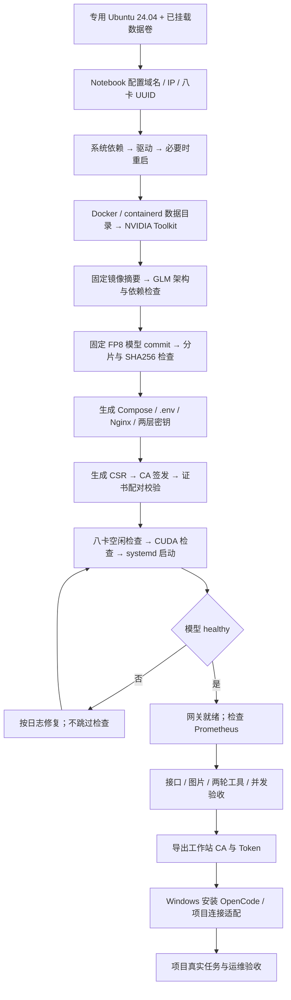
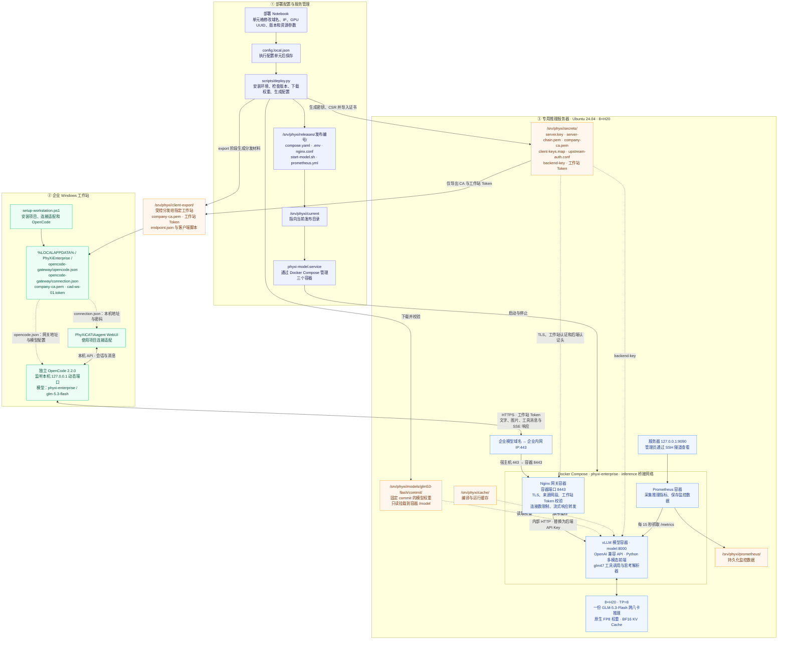

> 历史方案资料：此文描述旧部署流程。Notebook 已移除，新版入口与边界见仓库根目录 README。

# 部署与请求流程



## 部署架构与 OpenCode 请求链路



实线表示配置生成、服务管理或请求路径，虚线表示组件读取的配置、凭据与挂载文件。

- **配置生效**：修改 Notebook 并执行配置单元，再生成发布文件。运行中的部署先停止，变更已启动发布时使用新发布编号，随后启动并验收。
- **请求路径**：WebUI → 本机 OpenCode → Nginx → vLLM → 八张 H20；响应沿原路径返回。网关开放 `/v1/models` 和 `/v1/chat/completions`。
- **两层认证**：工作站 Token 由 `start-client.py` 读入 `PHYXI_GATEWAY_TOKEN` 环境变量，`opencode.json` 引用该变量。Nginx 验证后换成后端 API Key；后端 Key 和 TLS 私钥留在服务器。
- **端口与启动**：企业内网 IP 的 443 映射到网关 8443；模型 8000 不映射宿主机；监控 9090 只绑定服务器回环。网关等待模型健康后启动，Prometheus 没有该启动依赖。
- **工作站接入**：连接适配通过 `PHYXI_OPENCODE_CONNECTION` 读取 `connection.json`；OpenCode 通过 `OPENCODE_CONFIG` 读取自己的配置，使用 `NODE_EXTRA_CA_CERTS` 信任企业 CA。当前启动器默认禁止本地工具执行，业务工具按项目另行启用和验收。
- **目录**：图中 `/srv/phyxi` 为 `data_root` 默认值；首次修改后生成路径同步替换。`commit` 和“发布编号”代表实际模型 commit 与 `release` 值。Docker Engine 使用专用服务器的 `/var/run/docker.sock`，Docker 与 containerd 数据分别存放于数据根目录的 `docker/`、`containerd/`。

服务器目录（默认根目录；首次可在 Notebook 中设置 `data_root`）：

```text
/srv/phyxi/
├── docker/、containerd/        独立于系统盘的容器数据
├── models/glm53-flash/commit/  固定模型权重
├── cache/                     编译缓存
├── prometheus/                监控数据
├── secrets/                   API Key、工作站 Token、TLS 文件
├── artifacts/                 版本、镜像/模型清单、CSR
├── evidence/                  接口与负载验收结果
├── client-export/             仅管理员可读的工作站分发材料
├── releases/发布编号/          Compose、启动脚本、网关配置、.env
└── current -> releases/发布编号/
```
